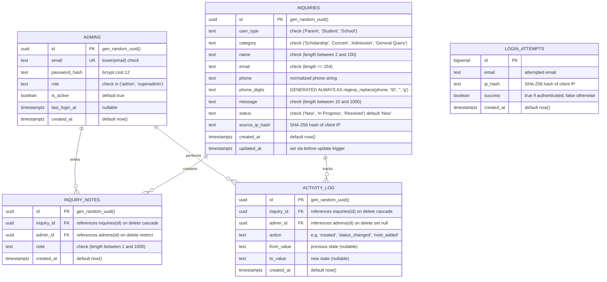

# Entity Relationship Diagram (ERD) - K12 Hunar CRM

This document describes the relational database schema implemented in `backend/schema.sql` for PostgreSQL on Supabase.

## Database Overview
- **Engine**: PostgreSQL 15+ (Supabase)
- **Extensions**: `pgcrypto` (UUID generation), `pg_trgm` (trigram substring and fuzzy indexing)
- **Design Philosophy**: Strict referential integrity (`CASCADE` / `SET NULL`), DB-level `CHECK` constraints, audit trails, and deterministic lowercase email storage.

## Indexes and Performance Rationale

| Index Name | Target Table | Definition | Query Pattern Supported |
|---|---|---|---|
| `idx_inquiries_created_at` | `inquiries` | `(created_at DESC)` | Default timeline sorting and recency queries |
| `idx_inquiries_category` | `inquiries` | `(category)` | Filtering by inquiry type |
| `idx_inquiries_user_type` | `inquiries` | `(user_type)` | Filtering by persona (Parent, Student, School) |
| `idx_inquiries_status` | `inquiries` | `(status)` | Pipeline status grouping and board columns |
| `idx_inquiries_cat_ut_created` | `inquiries` | `(category, user_type, created_at DESC)` | Composite query optimization for filtered lists |
| `idx_inquiries_name_trgm` | `inquiries` | `USING gin (lower(name) gin_trgm_ops)` | High-performance substring search (`ILIKE '%query%'`) |
| `idx_inquiries_phone_digits` | `inquiries` | `(phone_digits)` | Exact/prefix phone search on normalized digits |
| `idx_notes_inquiry_created` | `inquiry_notes` | `(inquiry_id, created_at DESC)` | Instant reverse-chronological retrieval of inquiry notes |
| `idx_activity_inquiry_created`| `activity_log` | `(inquiry_id, created_at DESC)` | Audit trail timeline in inquiry details drawer |
| `idx_login_attempts_email_time`| `login_attempts` | `(email, created_at DESC)` | 15-minute brute-force lockout window checks |
